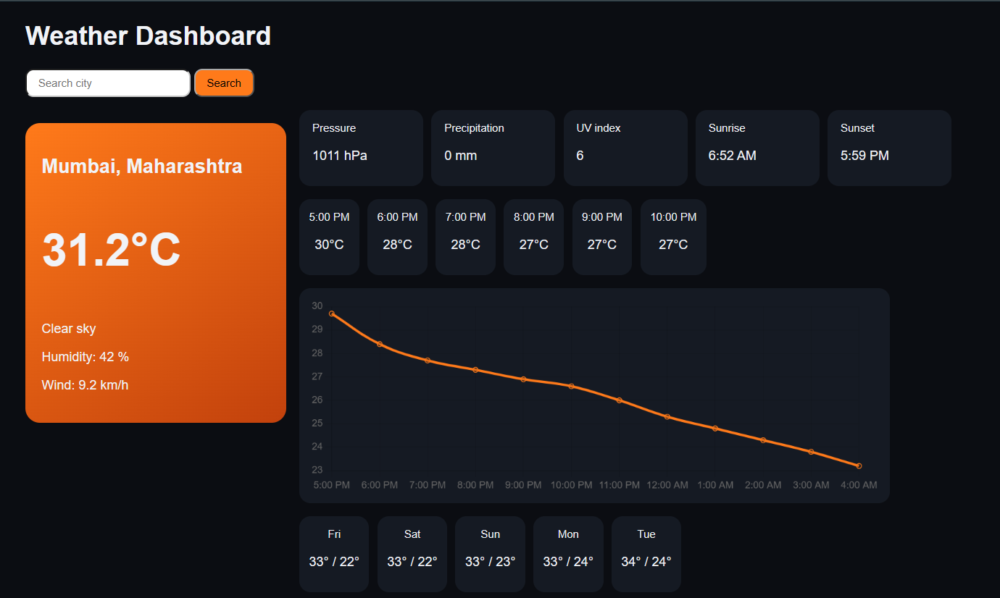

# 🌦️ Weather Dashboard

A sleek, responsive, single-file weather dashboard built with vanilla HTML, CSS, and JavaScript. Designed with a modern dark-teal & orange-gradient theme, it adapts seamlessly from a full desktop dashboard to a native-like **Mobile App layout** (sticky search header \+ fixed bottom navigation bar)—with zero API keys or build tools required.

🌐 **Live Demo:** [https\://vigneshbura.github.io/weather-dashboard/](https://vigneshbura.github.io/weather-dashboard/)



## ✨ Features

### 📊 Overview Dashboard

* **Hero Weather Card:** Orange-to-teal gradient card displaying live temperature, feels-like temp, daily High/Low, and dynamic day/night weather icons.  
* **Real-Time Metrics:** Humidity, Wind Speed, Visibility, Pressure, UV Index (with severity level), and Precipitation probability.  
* **12-Hour Temperature Trend:** Interactive line chart powered by Chart.js.  
* **Air Quality Index (US AQI):** Circular gauge with color-coded health categories (*Good, Moderate, Unhealthy, Very Unhealthy*).  
* **Sunrise & Sunset \+ Next 5 Days:** Quick daily outlook and daylight timings.

### 📱 Mobile-First App Experience

* **Sticky Top Header:** Compact brand header paired with an inline search bar.  
* **Fixed Bottom Navigation Bar:** 5-tab mobile navigation (*Overview, Forecast, Maps, Alerts, Settings*) with live alert counter badge.  
* **Optimized Card Grid:** Side-by-side AQI gauge and Temperature Trend chart, horizontal 5-day forecast strip, and auto-closing mobile keyboard on search.

### 📅 Detailed Forecast

* Smooth horizontal-scroll **Next 24 Hours** forecast with rain probabilities.  
* Complete **7-Day Forecast** with weather conditions, High/Low temperatures, rain %, wind speed, and UV index.

### 🗺️ Interactive Maps & Live Rain Radar

* Powered by **Leaflet.js** with **Esri Street Map** and **Esri Satellite (with labels)** layer switcher.  
* **Live Rain Radar** overlay toggle via RainViewer API.  
* **Click-Anywhere Weather:** Click any location on the map to fetch live temperature, weather condition, and wind speed in a popup.

### ⚠️ Automated Weather Alerts

* Automatically detects and prioritizes alerts for thunderstorms, heavy rain, extreme heat, cold waves, high UV, strong winds, poor AQI, and low visibility.  
* Live alert badge and optional **Browser Notifications** for severe alerts.

### 🔍 Worldwide Search (India-First)

* Dual-provider geocoding (**Open-Meteo \+ Photon**) that prioritizes Indian cities and states while supporting cities, states, and towns worldwide.

### ⚙️ Persistent Settings

* Switch between **°C / °F** and **12-hour / 24-hour** time formats.  
* Set a custom **Default City**, toggle **Alert Notifications**, or reset to defaults—all saved automatically in `localStorage`.

## 🛠️ Tech Stack & APIs

* **Frontend:** HTML5, CSS3 (Responsive Grid, Flexbox & Media Queries), Vanilla JavaScript  
* **Charts:** [Chart.js](https://www.chartjs.org/)  
* **Mapping:** [Leaflet.js](https://leafletjs.com/) \+ [Esri ArcGIS Tiles](https://www.arcgis.com/)  
* **Weather & Air Quality Data:** [Open-Meteo API](https://open-meteo.com/)  
* **Geocoding:** [Open-Meteo Geocoding](https://open-meteo.com/en/docs/geocoding-api) & [Photon by Komoot](https://photon.komoot.io/)  
* **Rain Radar:** [RainViewer API](https://www.rainviewer.com/api.html)

## 🚀 Getting Started

No installation, build step, or API keys are required.

1. **Clone the repository:**

```sh
git clone https://github.com/vigneshbura/weather-dashboard.git
cd weather-dashboard
```

2. **Run locally:** Open `index.html` directly in any modern web browser, or launch it with VS Code's **Live Server** extension.

## 📁 Project Structure

```
weather-dashboard/
├── index.html             # Complete single-file application (HTML, CSS, JS)
├── weather-dashboard.png  # Dashboard preview screenshot
└── README.md              # Project documentation
```

## 🌐 Deployment (GitHub Pages)

1. Push `index.html`, `README.md`, and `weather-dashboard.png` to the `main` branch.  
2. Go to **Repository Settings → Pages**.  
3. Under **Build and deployment**, select **Deploy from a branch** → **`main`** → **`/ (root)`** and click **Save**.

## 📄 License

This project is open source and available for personal and educational use.